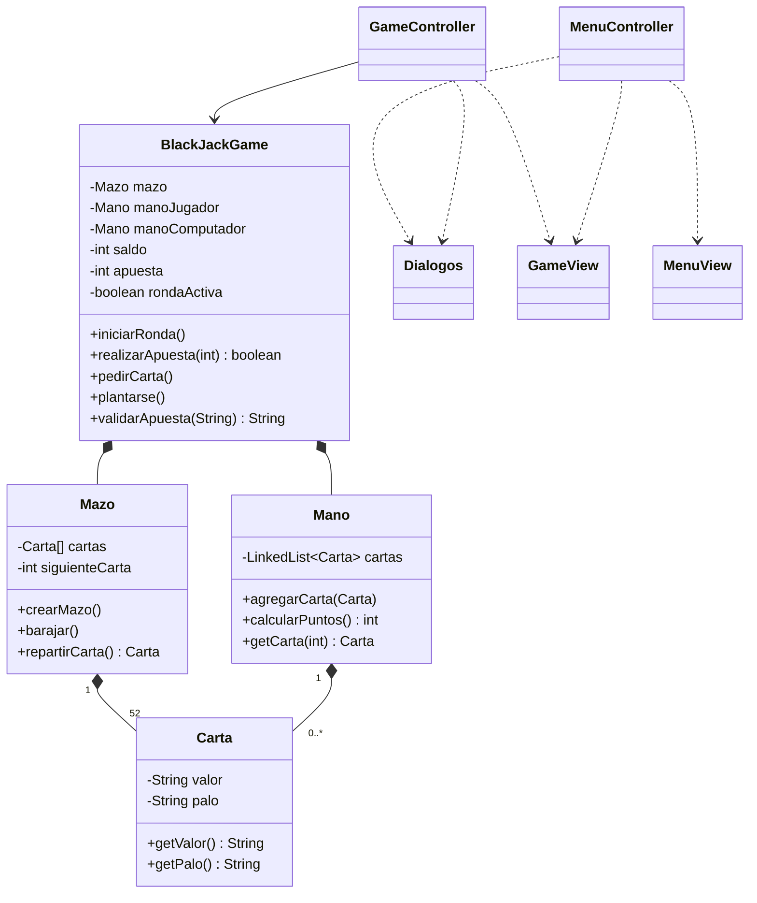

# UML final - 21 Black Jack

Este diagrama representa la estructura final implementada del proyecto.

El archivo editable está en [`UML_final.puml`](./UML_final.puml). Puede abrirse con PlantUML, IntelliJ IDEA con un complemento de PlantUML o cualquier visor compatible.

## Lectura del diseño

- `model` contiene las reglas y datos del juego.
- `controller` atiende eventos y comunica la vista con el modelo.
- `InterfazMenu` e `InterfazGame` contienen las vistas FXML y sus estilos CSS.
- `GameController` utiliza una instancia de `BlackJackGame`.
- `BlackJackGame` compone un mazo y dos manos.
- `PruebaBlackJack` verifica manualmente los casos principales del modelo.
