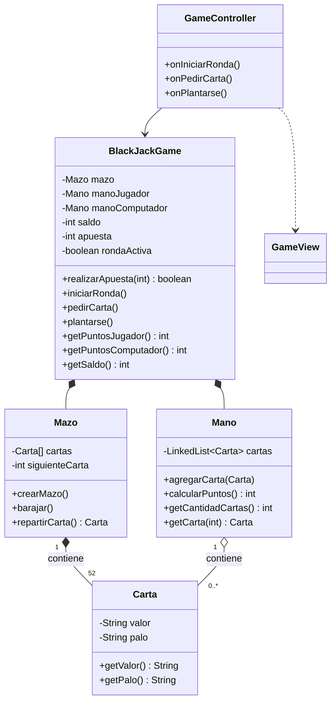

# UML inicial - 21 Black Jack

Diseño de clases con el que se comenzó el proyecto, a partir del enunciado (MVC, mazo de 52 posiciones, manos como lista enlazada). Editable en [`UML_inicial.puml`](./UML_inicial.puml).

## Cambios entre el UML inicial y el final
(ver `UML_final.md`; verificables en el historial de Git)

- Se agregaron `turnoComputador` y `resultado` en `BlackJackGame`, y las guardas de turno (`isRondaActiva`, `isTurnoComputador`).
- Se agregaron `validarApuesta(String)`, `tieneVeinteYMedio`, `esBlackJack` y `haySaldoSuficiente` en el modelo.
- Se agregaron `MenuController`, `Dialogos` y las vistas `MenuView` / `GameView`.
